# Egyptian Personnel Management System

**منظومة شئون الأفراد** — an Arabic-first, right-to-left web platform for government personnel affairs, built as a proof of concept for a public tender. It covers two systems on one shared core:

| System | Status |
| --- | --- |
| **Conscripts affairs** (منظومة شئون المجندين): receive conscript files from the Armed Forces, validate every record, review and approve, complete enlistment data, print barcode labels | Implemented end to end (backend, workers, UI, tests) |
| **Civilian employees** (منظومة العاملين المدنيين): Oracle 11g → SQL Server migration, employee records, job actions, e-archive, reports | Planned; permission-guarded placeholders only |

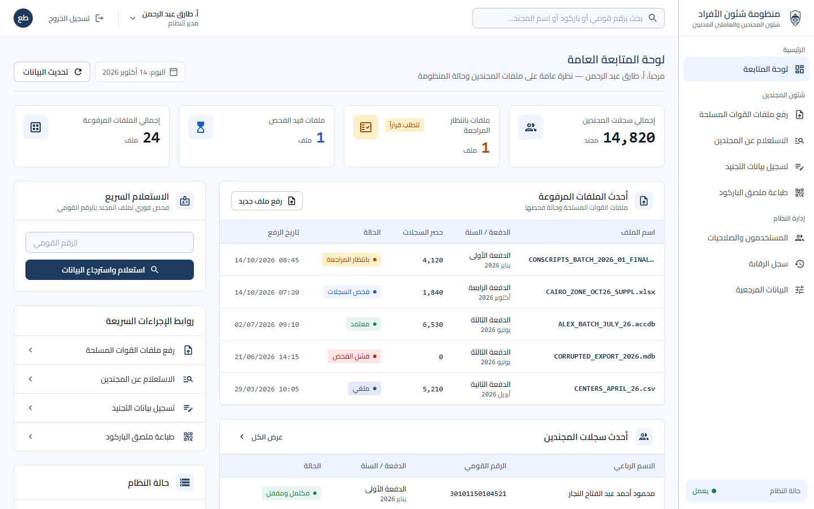

## Highlights

- **Complete conscript intake workflow**: upload Excel, CSV or Access files, validate every row in a background worker with live progress, review valid and rejected rows, approve or cancel, and export rejected rows with their reasons.
- **Strict validation**: 14-digit national IDs with embedded birth date, governorate and gender checks, qualification codes, duplicate detection within the file and against the database, with every rejection reason recorded.
- **Enlistment data entry**: police number and service dates, with the end date checked against the qualification's mandatory service period. Saving locks the record and assigns an immutable barcode. After that, only an administrator can correct it, with optimistic concurrency.
- **Barcode labels**: 50 × 25 mm Code 128 thermal labels. Every print is recorded in the audit log.
- **Role-based access**: two fixed roles (system administrator, data-entry operator). Every API route declares its permission, and denied attempts are audited.
- **Full audit trail**: logins, changes with old and new values, denied attempts and file decisions, searchable with a side-by-side change comparison. The application's database login cannot alter or delete audit rows.
- **Offline by design**: no CDNs, web fonts or external calls at runtime. Everything is bundled for an air-gapped intranet.
- **Arabic RTL interface** in a consistent institutional design system (Cairo font, navy palette, dense tables, Western digits for IDs and dates).

## Screenshots

| | |
| --- | --- |
| 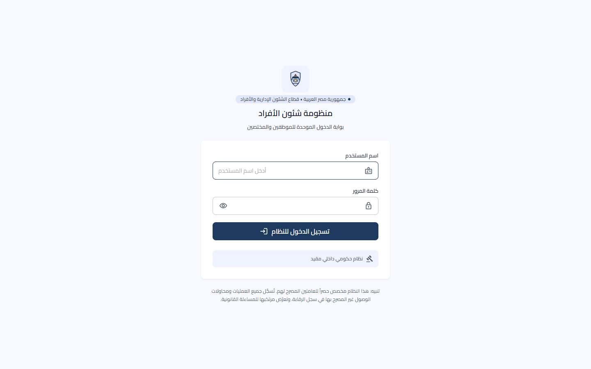 **Sign-in** | 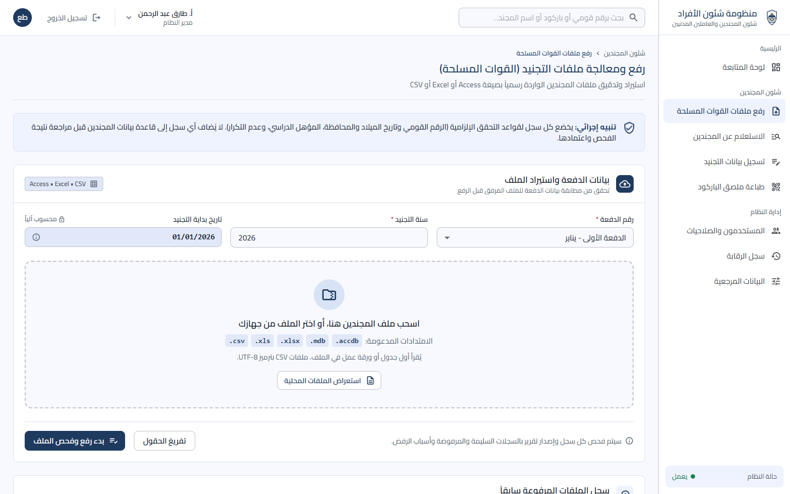 **Upload Armed Forces files** |
| 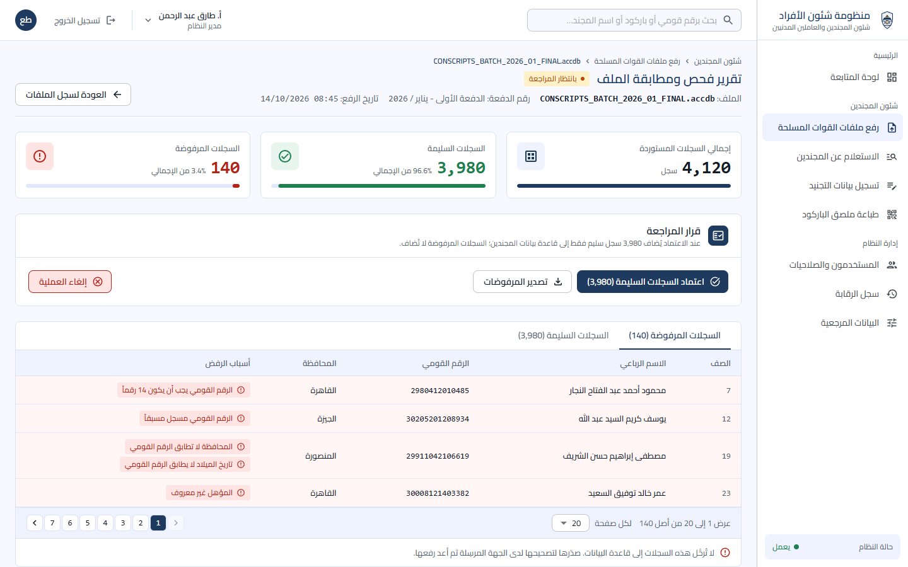 **Validation report and review decision** | 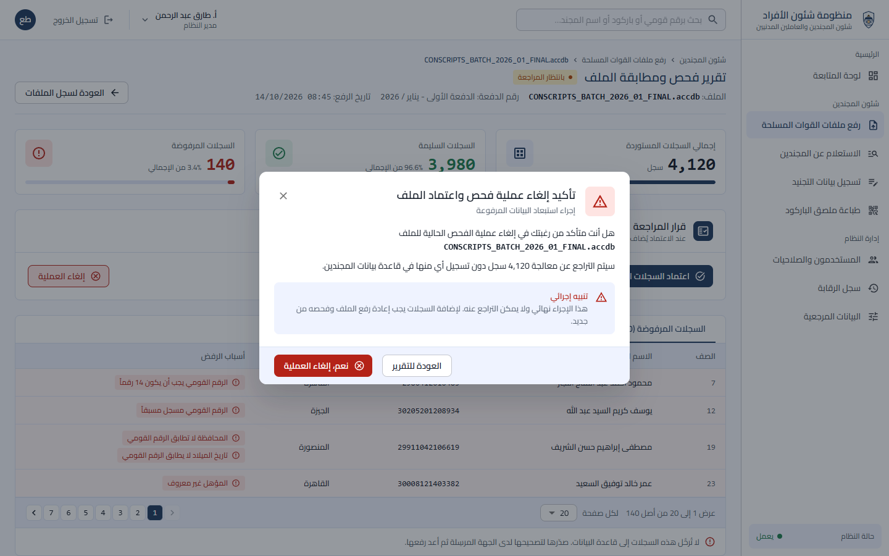 **Confirmation for irreversible actions** |
| 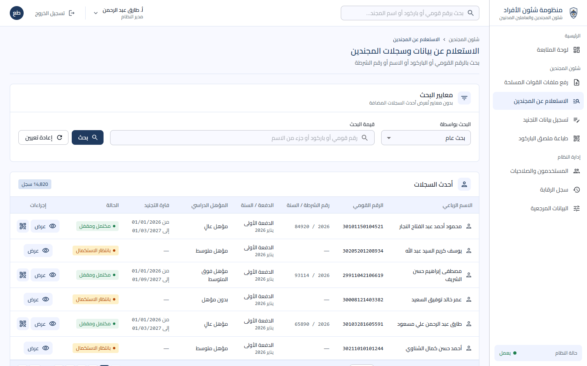 **Conscript search** | 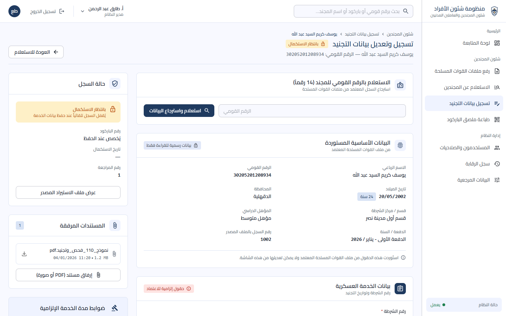 **Enlistment data entry** |
| 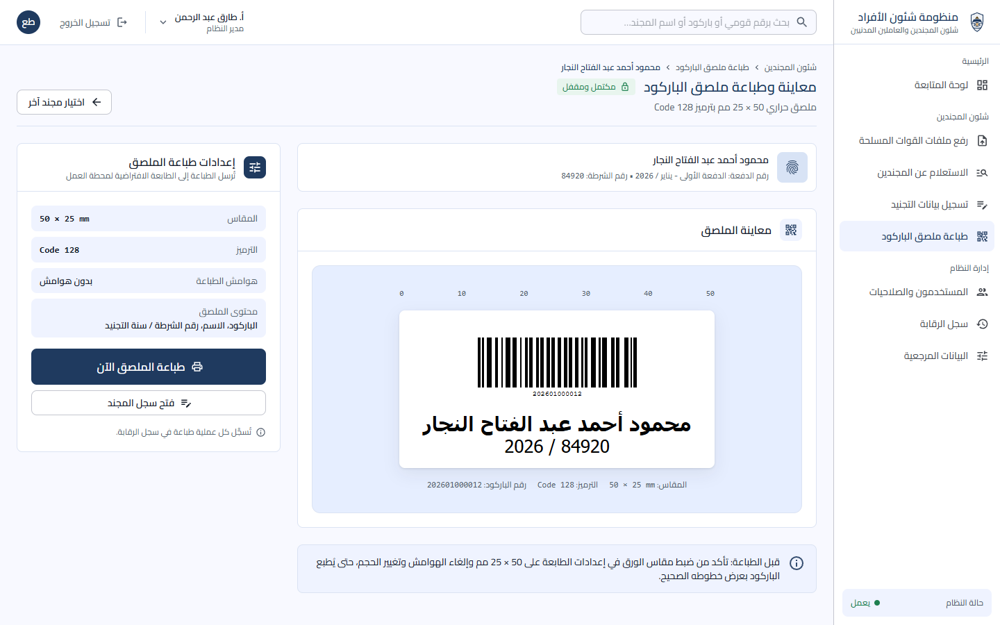 **Barcode label preview and printing** | 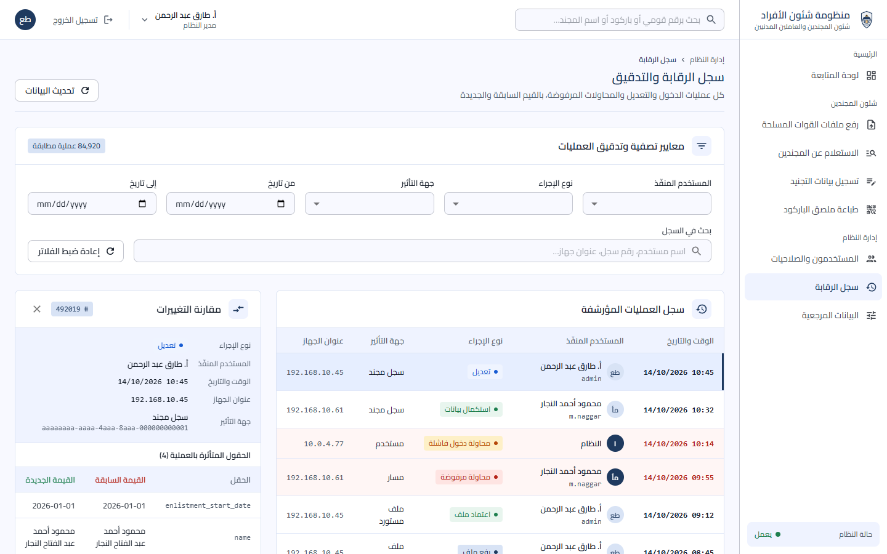 **Audit log with change comparison** |
| 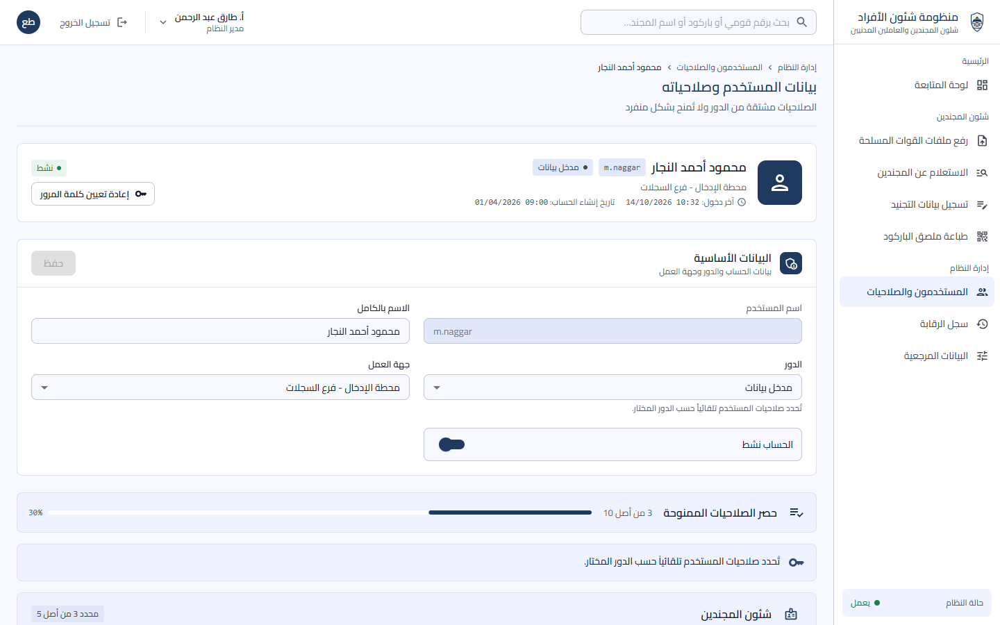 **Users, roles and derived permissions** | |

Screenshots show sample data.

## How it works

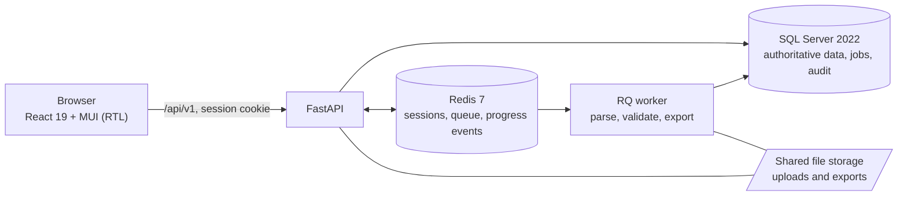

An import moves through `QUEUED → PARSING → VALIDATING → READY_FOR_REVIEW → APPROVED | CANCELLED` (or `FAILED`). The worker commits staged records, errors and a checkpoint every 250 rows, so a restart resumes where it stopped. New requests attempt RQ delivery immediately after SQL commit; a separate dispatcher recovers missed deliveries. Imports and exports have independent workers (one each by default). Rejected-row exports read and write in 500-row batches. The browser follows progress over server-sent events, with polling as a fallback. Approval inserts only valid rows, in one transaction, and rechecks the database for duplicates first.

Qualification determines the mandatory service period:

| Qualification ID | Qualification | Service |
| --- | --- | --- |
| 1 | Higher | 14 months |
| 3 | Above-average | 20 months |
| 2 | Intermediate | 26 months |
| 4 | None | 38 months |

Batches 1–4 start on 1 January, April, July and October of the enlistment year.

## Tech stack

| Layer | Choice |
| --- | --- |
| Database | SQL Server 2022, `NVARCHAR` text, `Arabic_100_CI_AS` collation; hand-written idempotent T-SQL migrations |
| Backend | Python 3.12, FastAPI, SQLAlchemy 2, Pydantic v2, pyodbc + ODBC Driver 18 |
| Jobs and sessions | Redis 7, Python RQ, with a SQL checkpoint and recovery dispatcher |
| Auth | Server-side sessions (HTTP-only, SameSite=Strict cookie, hashed token keys in Redis), Argon2 password hashing |
| Frontend | React 19, TypeScript 5.9 (strict), Vite, MUI with RTL, React Router, TanStack Query, React Hook Form + Zod |
| API types | Generated from FastAPI's OpenAPI schema with `openapi-typescript` |
| Tests | pytest (including real SQL Server/Redis integration), Vitest + Testing Library |

Only MIT, BSD, Apache-2.0 or ISC dependencies are used; see [docs/licenses.md](docs/licenses.md).

## Getting started (Windows)

### Prerequisites

- Git
- Python 3.12 (with the `py` launcher)
- Node.js 22+ LTS (24 recommended)
- Docker Desktop (Linux containers)
- Microsoft ODBC Driver 18 for SQL Server
- For Access imports and exports: a matching 64-bit Microsoft Access Database Engine (ODBC and ACE DAO). Excel and CSV imports don't need it.

On Ubuntu, Access imports (`.mdb` / `.accdb`) use MDB Tools: install it on the worker with `sudo apt-get install -y mdbtools`, then restart the worker. Access exports still require a Windows worker with the Microsoft Access engine; use XLSX exports on Ubuntu. Encrypted Access databases are not supported by MDB Tools.

With winget:

```powershell
winget install Python.Python.3.12 OpenJS.NodeJS.LTS Microsoft.msodbcsql.18 Docker.DockerDesktop Git.Git
```

### Run

```powershell
scripts\dev.ps1
```

On first run this creates `.env` from `.env.example` with generated database passwords and free ports, creates `backend\.venv`, and installs the backend and frontend dependencies. It then starts SQL Server and Redis in Docker, applies `backend\sql\*.sql` (creating or updating the `personnel` database), and starts the API (uvicorn with reload), the supervised import/export workers, recovery dispatcher and the frontend (Vite) as background processes. Logs and process IDs go to `storage\logs`.

- App: `http://localhost:<WEB_PORT>` (default 5173)
- Health: `http://localhost:<API_PORT>/api/v1/health`
- API docs (development only): `http://localhost:<API_PORT>/docs`

Ports are in `.env`. If 8000 is taken, setup picks the next free port.

### First sign-in

Run `scripts\create-admin.ps1` once. It prints a one-time password for `admin`, and the app asks for a new one at first login. The administrator then creates other users under إدارة النظام ← المستخدمون والصلاحيات.

### Stop

Use the `taskkill /PID <pid> /T /F` commands printed by `dev.ps1` to stop the application processes. `docker compose -f docker-compose.dev.yml stop` stops SQL Server and Redis. Database data stays in the `personnel-dev_mssql-data` volume.

## Scripts

| Script | What it does |
| --- | --- |
| `scripts\setup.ps1` | Idempotent setup: `.env`, venv, `pip install`, `npm ci`. Called by the others |
| `scripts\db-init.ps1` | Starts the database and applies `backend\sql\*.sql` in order. Idempotent |
| `scripts\dev.ps1` | Starts SQL Server, Redis, API, RQ worker and frontend |
| `scripts\test.ps1` | Initialises the database, then runs pytest, `tsc --noEmit` and Vitest. Exits 1 on any failure |
| `scripts\create-admin.ps1` | Creates the first administrator and prints a one-time password; `-Reset` resets an existing one |
| `scripts\worker.ps1` | Runs the supervised RQ worker and SQL recovery dispatcher in the current terminal; Ctrl+C stops both |
| `scripts\gen-types.ps1` | Regenerates `frontend/src/shared/api/schema.d.ts` from the OpenAPI schema (no running server needed) |

If PowerShell refuses to run scripts: `Set-ExecutionPolicy -Scope CurrentUser RemoteSigned`, or run them with `powershell -ExecutionPolicy Bypass -File scripts\dev.ps1`.

## Testing

```powershell
scripts\test.ps1
```

Synthetic import files with answer keys (1,000 and 10,000 records, 20% deliberately invalid across every validation rule) are in [test-data/](test-data/README.md) for manual and load testing of the upload and review screens.

Backend tests run against their own database (`personnel_test`), rebuilt from `backend/sql` on every run; the development database is never touched. They cover queue delivery and failure recovery, checkpoint resume, concurrent completion, approval conflicts, Access export and readback, protected downloads, and a live end-to-end run of the React screens against a real API and worker. Frontend tests cover routing and permission guards, the conscript screens and the enlistment date rules.

## Project structure

```
backend/
  app/
    main.py          app factory, routers; serves frontend/dist in production
    core/            config, database, roles and permissions, sessions, audit, errors
    auth/            login, logout, current user, change password
    admin/           users and roles, audit log, lookups
    recruits/        conscript imports, validation, jobs, profiles, labels, documents
    cli/             db_init, create_admin, worker, dispatcher, worker_supervisor
  sql/               numbered, idempotent T-SQL scripts (source of truth for the schema)
  tests/
frontend/
  src/
    app/             routes, providers, theme, layout (sidebar, top bar), dashboard
    features/        admin, auth, conscripts, employees (each owns its routes, API hooks and screens)
    shared/          API client and generated types, auth, permissions, i18n (ar.ts), UI kit
docs/                specifications, rules, plans, design system, screenshots
scripts/             PowerShell tooling for Windows
stitch_egyptian_personnel_management_system/   UI design reference (Google Stitch export)
```

## Database

- The T-SQL scripts in `backend/sql/` are the source of truth; the SQLAlchemy models mirror them, and a test fails if they drift. To change the schema, add a new numbered script; never edit one that has already run on a shared database.
- Two logins: `DB_ADMIN_USER` (sa in development) is used only by `db-init` to create the database, tables and the application login. `DB_USER` (`personnel_app`) is what the app runs as: read and write on data, no DDL, no `UPDATE`/`DELETE` on `audit_log`.
- Timestamps are stored in UTC.
- A DBA can apply the scripts without Python: `sqlcmd -S <server> -U <admin> -I -f 65001 -v DB_NAME=personnel APP_DB_USER=personnel_app APP_DB_PASSWORD=<...> -i backend\sql\001_database.sql`, and so on in order.

## Production

`npm run build` in `frontend/` produces `frontend/dist`. When that folder exists, the backend serves it at `/` with client-side routing fallback, and the API stays under `/api/v1`. Run the API and `python -m app.cli.worker_supervisor` as separately managed services with the same `.env` and shared storage; the supervisor restarts crashed workers with backoff, and the service manager should restart the supervisor itself. Use HTTPS, `ENV=prod` (disables the API docs) and `SESSION_COOKIE_SECURE=true`. For an offline deployment, bring Python wheels, the built frontend, container images and the Microsoft drivers onto the intranet in advance. See [docs/backend-poc.md](docs/backend-poc.md) for details.

## Documentation

| Document | Contents |
| --- | --- |
| [docs/backend-poc.md](docs/backend-poc.md) | Implemented conscripts backend: workflow, validation, API guide, deployment |
| [docs/business-rules.md](docs/business-rules.md) | Validation rules, date rules, lookups |
| [docs/permissions.md](docs/permissions.md) | Roles and every permission code |
| [docs/ui-design.md](docs/ui-design.md) | Design system, shared UI components, screen map |
| [docs/integration-status.md](docs/integration-status.md) | Integration and verification status |
| [docs/skeleton-plan.md](docs/skeleton-plan.md) | Original phased build plan |
| [docs/licenses.md](docs/licenses.md) | Third-party dependencies and their licences |

## Troubleshooting

- **`SRE module mismatch` or Python fails to start**: another program set `PYTHONHOME` machine-wide. The scripts clear it for their own process; in your own terminal run `Remove-Item Env:PYTHONHOME` first.
- **Backend can't reach the database at `localhost`**: use `DB_HOST=127.0.0.1`. `localhost` resolves to IPv6 `::1` first, and the container port is bound to IPv4 only.
- **VS Code says packages aren't installed**: select `backend\.venv\Scripts\python.exe` as the interpreter.
- **The original specification documents and `Person_data_S.mdb` aren't in the repository**: on purpose, since the sample may contain real personal data. Keep them in the repository root locally; they are gitignored.
